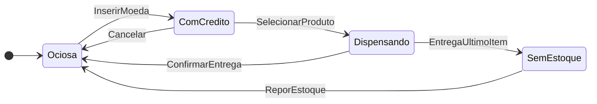

# Visão geral do projeto: MBT da Máquina de Vendas

**Tema 3 · Tópicos de Informática**

O que é o projeto, explicado do jeito mais simples possível.

> **Em uma frase:** a gente escreve um **desenho de como a máquina de vendas
> deve funcionar**, e um programa em Haskell usa esse desenho para **criar
> testes sozinho** e descobrir se uma máquina simulada **tem defeito**.

---

## 1. O que é Teste Baseado em Modelos (MBT)

Testar um sistema é conferir se ele faz o que deveria. Existem dois jeitos de
criar esses testes:

| Teste manual | Teste Baseado em Modelos |
|---|---|
| Uma pessoa pensa e escreve cada teste na mão. É fácil esquecer um caso, e quando o sistema muda, todos os testes precisam ser revistos. | A pessoa escreve só o **modelo**, uma descrição formal de como o sistema deve se comportar. Um programa lê o modelo e **gera os testes automaticamente**. |

Pense no modelo como o **manual de instruções** da máquina. Se o manual diz
"colocou moeda, a máquina passa a ter crédito", o programa cria um teste que
coloca moeda e confere se a máquina realmente ficou com crédito.

---

## 2. O exemplo escolhido: a Máquina de Vendas

A máquina sempre está em uma de **4 situações** (os estados):

- `Ociosa`: parada, esperando alguém. É onde ela começa.
- `ComCredito`: alguém colocou dinheiro.
- `Dispensando`: está entregando o produto.
- `SemEstoque`: acabaram os produtos.

E ela muda de situação quando acontece uma de **6 ações** (os eventos):
`InserirMoeda`, `Cancelar`, `SelecionarProduto`, `ConfirmarEntrega`,
`EntregaUltimoItem` e `ReporEstoque`.



Esse tipo de desenho, com estados e setas entre eles, se chama **Máquina de
Estados Finita (FSM)**.

---

## 3. Como o programa funciona: uma linha de montagem de testes

Cada integrante cuida de uma etapa, e cada etapa é um arquivo em `src/`.

| Etapa | Quem | Arquivo | O que faz |
|---|---|---|---|
| 0. As peças básicas | Victor | `Types.hs`, `FSM.hs` | Define o que é um estado, um evento, uma transição e uma FSM. Também tem as ferramentas para "andar" pela máquina: dado um estado e um evento, para onde ela vai? |
| 1. O modelo | Pedro | `Model.hs` | Escreve a Máquina de Vendas usando essas peças: os 4 estados, os 6 eventos e as 6 setas. Também mostra o modelo como texto e como grafo para os slides. |
| 2. O sistema testado (SUT) | Bruno | `SUT.hs` | Uma máquina "de verdade" simulada, que é o que vamos testar. Existem três versões: uma **correta** e duas **com defeito de propósito**, para mostrar que os testes pegam o erro. |
| 3. O gerador de testes | Gustavo | `Generator.hs` | Lê o modelo e cria os casos de teste sozinho. Para achar o caminho mais curto até cada estado, usa uma **busca em largura (BFS)**. |
| 4. O verificador | Lucas | `Verifier.hs` | Roda cada teste no SUT e compara o resultado com o que o modelo previa. Também cria testes negativos e calcula a porcentagem de cobertura. |
| 5. O programa principal | Caio | `Main.hs`, `README.md` | Junta tudo e mostra o resultado no terminal na hora da apresentação: o modelo, os testes gerados e a comparação entre o SUT correto e o SUT com defeito. |

```
Types.hs + FSM.hs  →  Model.hs  →  Generator.hs  →  Verifier.hs (roda no SUT.hs)  →  Main.hs
   peças básicas       modelo        gera testes        confere os resultados         relatório
```

---

## 4. Como é um caso de teste

Um caso de teste é só uma **lista de ações** e o **estado em que a máquina
deveria terminar**. O resultado esperado vem do modelo. Exemplo:

| Campo | Valor |
|---|---|
| Descrição | Testar a transição Cancelar |
| Ações | `InserirMoeda`, `Cancelar` |
| Deve terminar em | `Ociosa` (o modelo diz que cancelar devolve a moeda) |

O verificador roda essas ações nas duas máquinas simuladas:

| SUT | Onde terminou | Resultado |
|---|---|---|
| SUT correto | `Ociosa`, igual ao esperado | ✅ Teste passou |
| SUT com defeito | `ComCredito`, porque o defeito faz o Cancelar não funcionar | ❌ Teste falhou: defeito encontrado |

---

## 5. A ideia mais importante: critérios de cobertura

O gerador pode criar os testes seguindo regras diferentes. Essas regras se
chamam **critérios de cobertura**, e dizem o quanto do modelo os testes
precisam exercitar.

- **All-States:** os testes precisam **passar por todos os estados** pelo menos
  uma vez. Com uma única sequência (`InserirMoeda`, `SelecionarProduto`,
  `EntregaUltimoItem`) já visitamos os 4 estados. Mas só usamos 3 das 6 setas.
- **All-Transitions:** os testes precisam **passar por todas as setas** pelo
  menos uma vez. Dá mais trabalho, mas testa as 6 transições, inclusive
  `Cancelar` e `ReporEstoque`.

Esse é o ponto alto da apresentação. Os defeitos do Bruno estão justamente em
setas que o All-States não usa:

| SUT | Onde está o defeito | All-States | All-Transitions |
|---|---|---|---|
| Correto | nenhum | passa | passa |
| Com defeito | `Cancelar` fica em `ComCredito` | **não percebe** | **detecta** |
| Defeito de estoque | `ReporEstoque` não volta para `Ociosa` | **não percebe** | **detecta** |

> **A conclusão para falar na apresentação:** visitar todos os estados não
> basta. Para pegar mais defeitos, é preciso testar todas as transições.

---

## 6. Testes negativos

Além de testar o que a máquina **deve** fazer, testamos o que ela **não deve**
aceitar. Por exemplo, apertar `Cancelar` com a máquina `Ociosa` não faz
sentido, porque não tem moeda para devolver. O modelo não tem essa seta, então
esse evento deve ser recusado. O Lucas gera esses testes a partir dos eventos
que cada estado **não** aceita.

---

## 7. Vantagens e limitações do MBT

**Vantagens**
- Os testes são gerados automaticamente.
- Dá para medir a cobertura em porcentagem.
- Cada teste tem rastreabilidade: dá para saber de qual parte do modelo ele veio.
- Quando o sistema muda, basta atualizar o modelo e gerar de novo.

**Limitações**
- **Explosão de estados:** sistemas grandes têm estados demais para modelar.
- **Custo do modelo:** escrever e manter o modelo dá trabalho.
- **Depende do modelo estar certo:** se o modelo estiver errado, os testes
  também ficam errados.

---

## 8. O que precisa ser entregue

| Etapa | Pontos | O que conta |
|---|---|---|
| Entrega do trabalho | 2,0 | Material organizado, código funcionando, ligação entre teoria e prática e o mínimo de commits. |
| Arguição (perguntas) | 8,0 | Cada um explicar os conceitos e o código, inclusive as partes dos colegas. |

> **Duas regras eliminatórias:** (1) cada integrante precisa ter no mínimo
> 2 commits no GitHub, no próprio nome; (2) na arguição, qualquer um pode ser
> perguntado sobre qualquer arquivo.

Entregáveis finais:
- slides com a teoria e a demonstração;
- o código em Haskell, com instruções no `README.md`;
- a saída dos testes e o relatório comparativo;
- uma descrição curta do exemplo prático;
- o link do repositório, com pelo menos 12 commits no total.

---

## 9. Glossário

| Termo | Significado |
|---|---|
| **MBT** | Teste Baseado em Modelos. Os testes são gerados a partir de um modelo do sistema. |
| **Modelo** | A descrição formal de como o sistema deve se comportar. Aqui, a FSM da máquina de vendas. |
| **FSM** | Máquina de Estados Finita: estados, eventos e setas (transições) entre os estados. |
| **Estado** | A situação em que a máquina está, como `Ociosa` ou `ComCredito`. |
| **Evento** | Uma ação que acontece, como `InserirMoeda`. |
| **Transição** | Uma seta: "no estado X, com o evento Y, vai para o estado Z". |
| **SUT** | System Under Test, o sistema que está sendo testado. Aqui é uma máquina simulada. |
| **Caso de teste** | Uma lista de ações e o estado em que a máquina deveria terminar. |
| **Cobertura** | Quanto do modelo os testes exercitaram, em porcentagem. |
| **BFS** | Busca em largura. Explora o grafo por camadas e acha o caminho mais curto até cada estado. |
| **Teste negativo** | Um teste que manda um evento que não é permitido e confere se ele é recusado. |
| **Haskell** | A linguagem do projeto. É funcional: o programa é feito de funções que transformam dados. |
